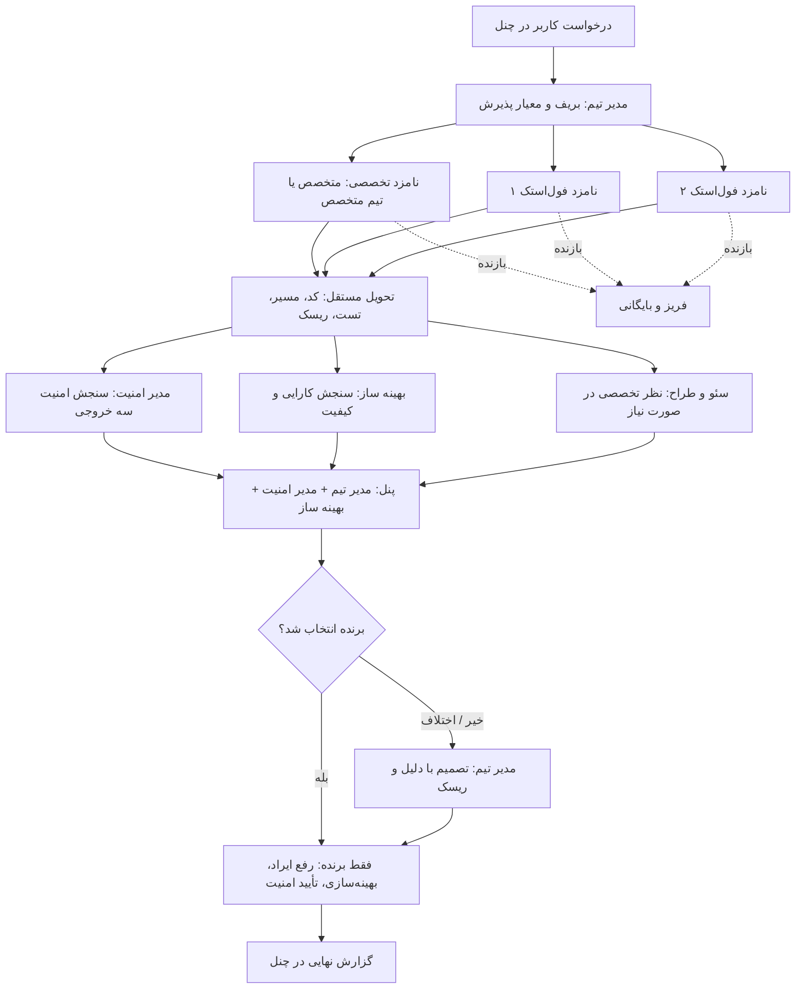

# گردش کار تیم توسعه

چنل: «تیم توسعه» — ۱۲ عضو، رهبر: مدیر تیم توسعه.

## اعضا

| نقش | وظیفه اصلی |
|---|---|
| مدیر تیم توسعه | صاحب درخواست، بریف، تقسیم کار، ریاست پنل، گزارش نهایی |
| طراح UI/UX | جریان کاربر، وایرفریم، سیستم طراحی، مشخصات تحویل |
| توسعه‌دهنده بک‌اند | API، دیتابیس، احراز هویت، منطق سرور |
| توسعه‌دهنده فرانت‌اند | پیاده‌سازی رابط، اتصال به API، واکنش‌گرایی |
| کد نویس | اسکریپت، باگ، تست، کارهای عمومی کد |
| کارشناس سئو | سئوی فنی و محتوایی، کلمات کلیدی، ممیزی |
| فول‌استک ۱ | نامزد مستقل، پیاده‌سازی کامل در همه لایه‌ها |
| فول‌استک ۲ | نامزد مستقل، پیاده‌سازی کامل در همه لایه‌ها |
| بازبین امنیت | بازبینی کد و معماری بر پایه OWASP |
| متخصص تست نفوذ | تست مجاز و غیرمخرب با محدوده مشخص |
| مدیر امنیت | مدل تهدید، هدایت تیم امنیت، تأیید نهایی، عضو پنل |
| بهینه ساز | کارایی، هزینه، کیفیت و نگهداشت‌پذیری، عضو پنل |

## نمودار



## گام‌ها

1. **دریافت و بریف** — کاربر درخواست را در چنل می‌نویسد. مدیر تیم دامنه، معیار پذیرش، ورودی‌ها و محدودیت‌ها را در یک بریف یکسان می‌نویسد. سوال از کاربر فقط برای تصمیم محصولی، دسترسی یا ریسک.
2. **ساخت موازی سه خروجی** — همان بریف همزمان به سه نامزد می‌رود:
   - نامزد تخصصی: یک متخصص یا ترکیب متخصص‌ها که یک خروجی واحد تحویل می‌دهد.
   - فول‌استک ۱
   - فول‌استک ۲

   هر نامزد در پوشه جدا و ایزوله کار می‌کند و تا تحویل به کد دیگری نگاه نمی‌کند.
3. **تحویل** — هر نامزد در چنل اعلام می‌کند: چه ساخته شد، مسیر فایل، نحوه اجرا و تست، نتیجه تست، تصمیم فنی و ریسک. بعد از تحویل تا تصمیم پنل تغییری نمی‌دهد.
4. **سنجش** — مدیر امنیت (با بازبین امنیت و در صورت اجازه با تست نفوذ) امنیت هر سه را بررسی می‌کند. بهینه ساز با اندازه‌گیری واقعی کارایی، هزینه و کیفیت را می‌سنجد. سئو و طراح در صورت نیاز نظر می‌دهند.
5. **پنل** — مدیر تیم (رئیس)، مدیر امنیت و بهینه ساز هر نامزد را ۱ تا ۵ نمره می‌دهند. جدول نمره‌ها با دلیل در چنل منتشر می‌شود. برنده بالاترین نمره وزنی است؛ در اختلاف کمتر از ۵٪، ریسک و هزینه نگهداری کمتر تعیین می‌کند و مدیر تیم دلیل را ثبت می‌کند.
6. **ادامه فقط روی برنده** — بازنده‌ها فریز و بایگانی می‌شوند. بهینه ساز برنده را بدون تغییر رفتار بهینه می‌کند و عدد قبل/بعد می‌دهد. مدیر امنیت تأیید نهایی می‌دهد. نویسنده برنده ایرادهای باقی‌مانده را رفع می‌کند.
7. **گزارش نهایی** — مدیر تیم: چه آماده است، چه تست شده، اعداد کارایی، نتیجه امنیت، ریسک باقی‌مانده و قدم بعد.

## معیار نمره‌دهی پنل

| معیار | وزن | سنجش |
|---|---|---|
| درستی و کامل بودن | ۳۰٪ | اجرا، تطابق با معیار پذیرش، تست |
| امنیت | ۲۵٪ | مدل تهدید، احراز هویت و مجوز، ورودی، وابستگی |
| کارایی و کیفیت | ۲۰٪ | زمان پاسخ، منابع، اندازه، کوئری |
| نگهداشت‌پذیری | ۱۰٪ | خوانایی، ساختار، مستندسازی، وابستگی |
| UX و سئو | ۱۰٪ | جریان کاربر، دسترس‌پذیری، متادیتا، ساختار |
| ریسک تحویل | ۵٪ | وابستگی خارجی، ابهام، هزینه ادامه |

نمره وزنی = مجموع (وزن × نمره ÷ ۵) — حداکثر ۱۰۰.

## ساختار فایل‌ها

```
/home/saidev/OpenBot/Shared/<نام-پروژه>/
├── BRIEF.md
├── candidates/
│   ├── specialist/
│   ├── fullstack-1/
│   └── fullstack-2/
└── panel/
    ├── security.md
    ├── optimizer.md
    └── decision.md
```

## قواعد

- همه‌چیز در چنل؛ هیچ عضوی مستقیم به کاربر پیام نمی‌دهد.
- بریف برای هر سه نامزد یکسان است.
- تست نفوذ فقط با اجازه صریح کاربر و محدوده نوشته‌شده.
- نتیجه بدون اجرا یا اندازه‌گیری ادعا نمی‌شود.
- کار کوچک (حدود ۲۰ دقیقه) می‌تواند بدون مسابقه باشد، با ذکر دلیل در چنل.
- ورک‌فلوی آماده در OpenBot: «پنل داوری تیم توسعه» (اجرای دستی، برای زمانی که سه خروجی آماده است).
